<a href="https://inaciorodrigues.dev.br/">
  <picture>
    <source media="(prefers-color-scheme: dark)" srcset="assets/header-dark.svg">
    
  </picture>
</a>

  <a href="https://inaciorodrigues.dev.br/"><picture><source media="(prefers-color-scheme: dark)" srcset="assets/contact/site-dark.svg"></picture></a>
  <a href="https://www.linkedin.com/in/inacio-rodrigues-dev/"><picture><source media="(prefers-color-scheme: dark)" srcset="assets/contact/linkedin-dark.svg"></picture></a>
  <a href="mailto:inaciormgalvao@outlook.com"><picture><source media="(prefers-color-scheme: dark)" srcset="assets/contact/email-dark.svg"></picture></a>

## 👨‍💻 Sobre mim

Sou **Inácio Rodrigues de Matos Galvão**, desenvolvedor full stack sênior e engenheiro de computação pela UFC. Projeto, construo e opero software sob medida: do código aos servidores, domínio, e-mails, monitoramento e evolução contínua.

- ⚡ **B&Q Energia** · desenvolvedor de sistemas sênior, cuidando de aplicações críticas em Kubernetes multi-cluster
- 🎓 **NeuroArq Academy** · full stack nas plataformas educacionais
- 🕹️ **TCC** · teleoperação em tempo real com force feedback (Raspberry Pi, ESP32, UDP e interface háptica)
- 🤖 **Portfólio** · Next.js 16 com a Mika, uma assistente de IA que recebe a ideia do projeto e me entrega organizada
- 💬 Gosto de conversar sobre arquitetura, Kubernetes, Next.js, Python e sistemas embarcados

## 🧰 Stack

<table>
  <tr>
    <td align="right"><b>Linguagens</b></td>
    <td><picture><source media="(prefers-color-scheme: dark)" srcset="assets/stack/linguagens-dark.svg"></picture></td>
  </tr>
  <tr>
    <td align="right"><b>Front-end</b></td>
    <td><picture><source media="(prefers-color-scheme: dark)" srcset="assets/stack/frontend-dark.svg"></picture></td>
  </tr>
  <tr>
    <td align="right"><b>Back-end e dados</b></td>
    <td><picture><source media="(prefers-color-scheme: dark)" srcset="assets/stack/backend-dark.svg"></picture></td>
  </tr>
  <tr>
    <td align="right"><b>Infra e DevOps</b></td>
    <td><picture><source media="(prefers-color-scheme: dark)" srcset="assets/stack/infra-dark.svg"></picture></td>
  </tr>
  <tr>
    <td align="right"><b>Hardware e visão</b></td>
    <td><picture><source media="(prefers-color-scheme: dark)" srcset="assets/stack/hardware-dark.svg"></picture></td>
  </tr>
</table>

## 🚀 Projetos em destaque

  <a href="https://github.com/inacio-dev/monografia"><picture><source media="(prefers-color-scheme: dark)" srcset="assets/projects/teleoperacao-dark.svg"></picture></a>
  <a href="https://inaciorodrigues.dev.br/"><picture><source media="(prefers-color-scheme: dark)" srcset="assets/projects/beq-energia-dark.svg"></picture></a>
  <a href="https://inaciorodrigues.dev.br/"><picture><source media="(prefers-color-scheme: dark)" srcset="assets/projects/neuroarq-dark.svg"></picture></a>
  <a href="https://inaciorodrigues.dev.br/"><picture><source media="(prefers-color-scheme: dark)" srcset="assets/projects/bcm-promotora-dark.svg"></picture></a>

## 📊 Atividade

<picture>
  <source media="(prefers-color-scheme: dark)" srcset="https://raw.githubusercontent.com/inacio-dev/inacio-dev/output/profile-3d-dark.svg">
  
</picture>

  
  

🏢 <b>Contribuições em organizações</b>

 

  

<picture>
  <source media="(prefers-color-scheme: dark)" srcset="https://raw.githubusercontent.com/inacio-dev/inacio-dev/output/snake-dark.svg">
  
</picture>

🇺🇸 <b>English</b>

 

I'm **Inácio Rodrigues de Matos Galvão**, a senior full stack developer and computer engineer (Federal University of Ceará, Brazil). I design, build and run custom software end to end, from the code to servers, domains, e-mail, monitoring and ongoing improvements.

- ⚡ **B&Q Energia** · senior systems developer working on critical applications running on multi-cluster Kubernetes
- 🎓 **NeuroArq Academy** · full stack developer on the education platforms
- 🕹️ **Thesis** · real-time teleoperation with force feedback (Raspberry Pi, ESP32, UDP and a haptic interface)
- 🤖 **Portfolio** · Next.js 16 with Mika, an AI assistant that takes in project ideas — [inaciorodrigues.dev.br](https://inaciorodrigues.dev.br/)

 

<picture>
  <source media="(prefers-color-scheme: dark)" srcset="assets/footer-dark.svg">
  
</picture>
