<a href="https://inaciorodrigues.dev.br/">
  <picture>
    <source media="(prefers-color-scheme: dark)" srcset="assets/header-dark.svg">
    
  </picture>
</a>

  <a href="https://inaciorodrigues.dev.br/"><picture><source media="(prefers-color-scheme: dark)" srcset="assets/contact/site-dark.svg"></picture></a>
  <a href="https://www.linkedin.com/in/inacio-rodrigues-dev/"><picture><source media="(prefers-color-scheme: dark)" srcset="assets/contact/linkedin-dark.svg"></picture></a>
  <a href="mailto:inaciormgalvao@outlook.com"><picture><source media="(prefers-color-scheme: dark)" srcset="assets/contact/email-dark.svg"></picture></a>

## 👨‍💻 Sobre mim

Sou **Inácio Rodrigues de Matos Galvão**, analista de sistemas sênior, desenvolvedor full stack e engenheiro de computação pela UFC. Projeto, construo e opero software sob medida: do código aos servidores, domínio, e-mails, monitoramento e evolução contínua.

- ⚡ **B&Q Energia** · analista de sistemas sênior; lidero a validação técnica das features críticas e projetei a infraestrutura que atende uma empresa de cerca de 5 mil colaboradores
- 🏭 **Grupo Argo** · projetos sob demanda: o SaaS Vertere Mind, com assistente de IA, e o SmartKitchen, controle de estoque multiempresa com app móvel
- 🧠 **NeuroArq** · projetos sob demanda: site institucional multilíngue com CMS próprio e ferramentas internas integradas à OpenAI
- 🏦 **BCM Promotora** · projeto sob demanda concluído: site de captação, sistema de propostas de consignado e migração da plataforma anterior
- 🕹️ **TCC** · veículo teleoperado com force feedback, [publicado no repositório da UFC](https://repositorio.ufc.br/handle/riufc/87035) e exposto no Siará Tech Summit 2026
- 🎼 **Symbra** · pesquisa voluntária de leitura de partituras para braille, para músicos cegos, financiada pelo Programa Centelha
- 💬 Gosto de conversar sobre arquitetura, back-end, infraestrutura, IA aplicada e sistemas embarcados

## 🧰 Stack

<table>
  <tr>
    <td align="right"><b>Linguagens</b></td>
    <td><picture><source media="(prefers-color-scheme: dark)" srcset="assets/stack/linguagens-dark.svg"></picture></td>
  </tr>
  <tr>
    <td align="right"><b>Front-end</b></td>
    <td><picture><source media="(prefers-color-scheme: dark)" srcset="assets/stack/frontend-dark.svg"></picture></td>
  </tr>
  <tr>
    <td align="right"><b>Back-end e dados</b></td>
    <td><picture><source media="(prefers-color-scheme: dark)" srcset="assets/stack/backend-dark.svg"></picture></td>
  </tr>
  <tr>
    <td align="right"><b>Infra e DevOps</b></td>
    <td><picture><source media="(prefers-color-scheme: dark)" srcset="assets/stack/infra-dark.svg"></picture></td>
  </tr>
  <tr>
    <td align="right"><b>Hardware e visão</b></td>
    <td><picture><source media="(prefers-color-scheme: dark)" srcset="assets/stack/hardware-dark.svg"></picture></td>
  </tr>
  <tr>
    <td align="right"><b>Também</b></td>
    <td><code>Fastify</code> <code>gRPC</code> <code>BullMQ</code> <code>Playwright</code> <code>React Native (Expo)</code> <code>OpenAI</code></td>
  </tr>
</table>

## 🚀 Projetos em destaque

  <a href="https://inaciorodrigues.dev.br/"><picture><source media="(prefers-color-scheme: dark)" srcset="assets/projects/beq-energia-dark.svg"></picture></a>
  <a href="https://inaciorodrigues.dev.br/"><picture><source media="(prefers-color-scheme: dark)" srcset="assets/projects/grupo-argo-dark.svg"></picture></a>
  <a href="https://inaciorodrigues.dev.br/"><picture><source media="(prefers-color-scheme: dark)" srcset="assets/projects/neuroarq-dark.svg"></picture></a>
  <a href="https://inaciorodrigues.dev.br/"><picture><source media="(prefers-color-scheme: dark)" srcset="assets/projects/bcm-promotora-dark.svg"></picture></a>
  <a href="https://repositorio.ufc.br/handle/riufc/87035"><picture><source media="(prefers-color-scheme: dark)" srcset="assets/projects/teleoperacao-dark.svg"></picture></a>
  <a href="https://inaciorodrigues.dev.br/"><picture><source media="(prefers-color-scheme: dark)" srcset="assets/projects/symbra-dark.svg"></picture></a>

## 📊 Atividade

<picture>
  <source media="(prefers-color-scheme: dark)" srcset="https://raw.githubusercontent.com/inacio-dev/inacio-dev/output/profile-3d-dark.svg">
  
</picture>

  
  

🏢 <b>Contribuições em organizações</b>

 

  

<picture>
  <source media="(prefers-color-scheme: dark)" srcset="https://raw.githubusercontent.com/inacio-dev/inacio-dev/output/snake-dark.svg">
  
</picture>

🇺🇸 <b>English</b>

 

I'm **Inácio Rodrigues de Matos Galvão**, a senior systems analyst, full stack developer and computer engineer (Federal University of Ceará, Brazil). I design, build and run custom software end to end, from the code to servers, domains, e-mail, monitoring and ongoing improvements.

- ⚡ **B&Q Energia** · senior systems analyst; I lead the technical validation of critical features and designed the infrastructure serving a company of about 5,000 employees
- 🏭 **Grupo Argo** · on-demand projects: Vertere Mind, a SaaS with an AI assistant, and SmartKitchen, multi-tenant inventory control with a mobile app
- 🧠 **NeuroArq** · on-demand projects: a multilingual website with its own CMS and internal tools integrated with OpenAI
- 🏦 **BCM Promotora** · completed on-demand project: lead capture website, payroll-loan proposal system and migration from the previous platform
- 🕹️ **Thesis** · teleoperated vehicle with force feedback: 1.94 ms UDP latency, 29.9 FPS video and 97.2% force feedback accuracy
- 🎼 **Symbra** · volunteer research on reading sheet music into braille for blind musicians
- 🤖 **Portfolio** · [inaciorodrigues.dev.br](https://inaciorodrigues.dev.br/)

 

<picture>
  <source media="(prefers-color-scheme: dark)" srcset="assets/footer-dark.svg">
  
</picture>
